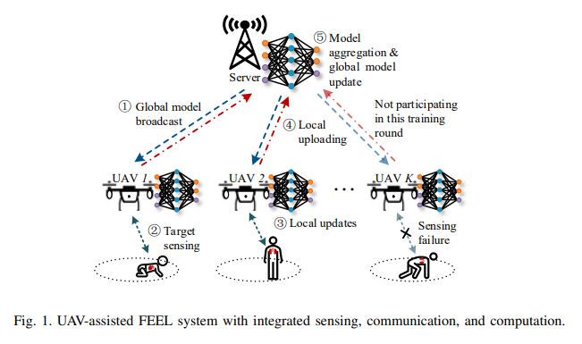
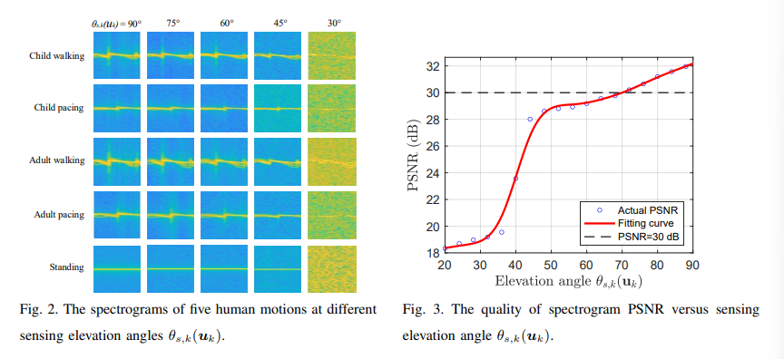
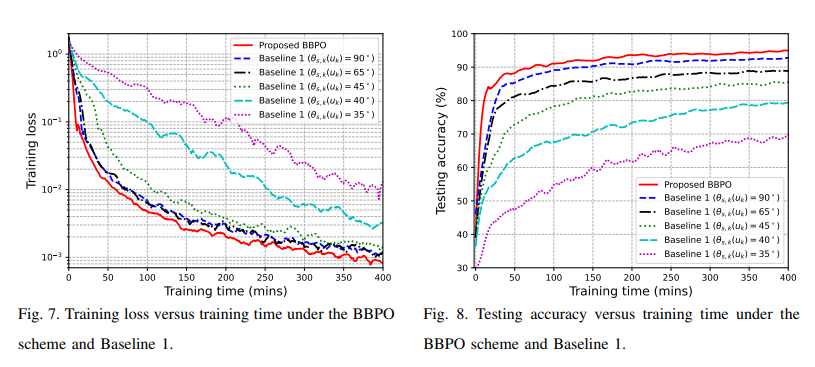

# [UAV+ISAC] Drone + Federated Learning: How to Break Through Technical Bottlenecks? This Optimization Scheme Elevates Training Efficiency by a Notch [with Python Code]

However, despite their seemingly perfect combination, there are three major challenges:
1. Communication - Perception contradiction
The drone's positioning too close to the target can affect its communication efficiency with the server, while being too far can reduce data quality.
2. Resource competition dilemma
The limited onboard resources for perception, computation, and communication among drones need to be allocated in a way that avoids internal conflicts.
3. Training efficiency bottleneck
In non-ideal environments, drones may fail to perceive, leading to increased data heterogeneity and slowing down model convergence.
This paper proposes a Bandwidth-Batch Size-Position (BBPO) optimization scheme, which deeply couples drone deployment and resource allocation for the first time. It has been validated in the human action recognition scenario, showing superiority compared to traditional methods. The experiments show that this scheme reduces training time by 20%-60% and significantly improves test accuracy.
Key breakthrough: From perception mechanism to optimization model innovation across the entire chain.
1. "Golden Angle" of perception quality: A study on elevation angle of 70° found that the perception quality of drones towards human actions (measured by PSNR from micro Doppler spectrum) is strongly correlated with the perception angle:
When the angle is ≥70°, the PSNR stabilizes at over 30dB, meeting the training requirements;
Below this threshold, obstructions and signal attenuation lead to spectral blurring (as shown in Figure 2, where the spectrum almost cannot distinguish the action at an 30° elevation angle).
This finding provides clear constraints for drone deployment: keeping an elevation angle of 70° or more is enough to balance quality and energy consumption without blindly approaching the target.
2. Federated learning convergence secret: Uniform perception probability through deriving the upper bound of training loss reveals that:
Drone perception success rates vary unevenly can increase data heterogeneity, leading to slower model convergence;
When all drones have the same perception probability, the negative impact can be significantly mitigated, accelerating convergence by 30%.
This means that it is more important to ensure uniform perception success rates among drone groups than to pursue individual drone performance to the extreme.
3. BBPO Optimization Scheme: Three-Variable Interaction to Solve Difficulties for Mixed Integer Non-Convex Optimization Problems. The scheme is decomposed into three subproblems that are solved alternatively:
Bandwidth allocation
Allocate more bandwidth to the drone with long computation time, balance the transmission time of each node.
Batch size design
Maximize sample size within the delay constraint to reduce training iterations.
Position optimization
Based on the inverse perception probability, we aim to optimize the coordinates so that the drone can "see clearly" the target and "explain clearly" the data.
Experimental verification: The BBPO scheme outperforms traditional methods in the human action recognition scenario of 8 drones (identifying 5 types of actions: children walking / running, adults walking / running, standing), with the BBPO scheme delivering an impressive performance.
Convergence speed
The time to reach a training loss of 0.002 is 20% less than the equal bandwidth scheme and 33% less than the fixed batch size scheme.
Test accuracy
90% accuracy achieved 30% faster than the best baseline, approaching the ideal scenario of unnoticeable failures.
Resource balancing
Perception, computation, and communication times for various drones are becoming increasingly consistent (as shown in Figure 6), avoiding resource waste.
Compare the baseline schemes with different angles (35°-90°), BBPO loses one order of magnitude in loss value within the same time due to dynamic position adjustment (as shown in Figure 7).
Conclusion and Outlook: The Next Generation Paradigm of UAV Intelligent Training. This study demonstrates that by jointly optimizing the deployment and resource allocation of UAVs, the efficiency of federated edge learning can be significantly enhanced. The core value of the BBPO scheme lies in:
The study reveals the key impact of perceptual probability uniformity on the convergence of federated learning.
A set of practical and feasible multi-variable optimization frameworks is provided, which are both theoretically rigorous and engineering practical.
In the future, combining reinforcement learning to achieve dynamic environment adaptation or integrating semantic communication to reduce data transmission volume will be further breakthrough directions. For scenarios such as drone inspection and emergency rescue with high real-time requirements, this solution has shown industrial potential.
End

## Images

<!-- PAYMENT_BLOCK -->

## Get this dataset

- Payment link (Stripe): [Buy now](https://buy.stripe.com/3cs8yP7sY87d0vu9AB)
- Payment QR code: 

<!-- /PAYMENT_BLOCK -->
